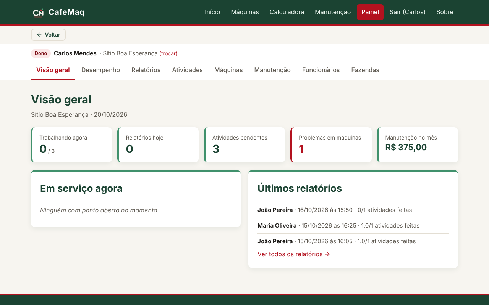
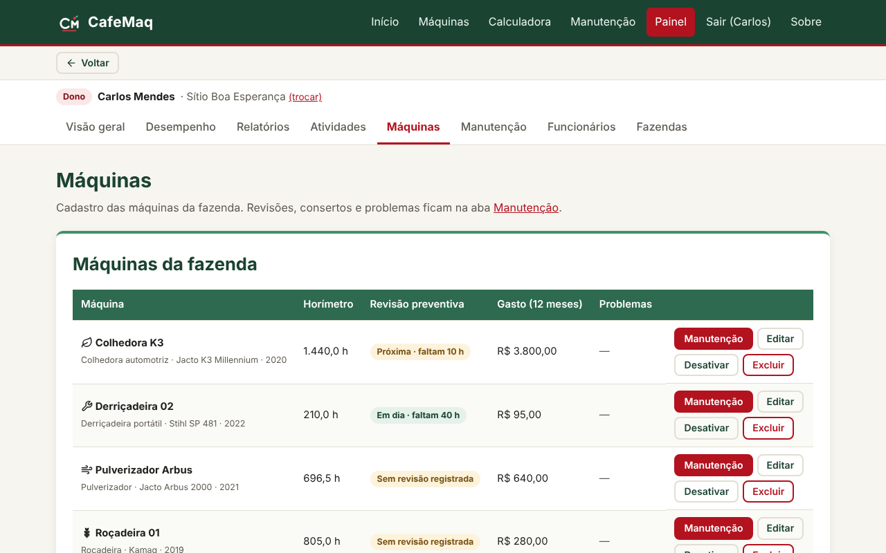
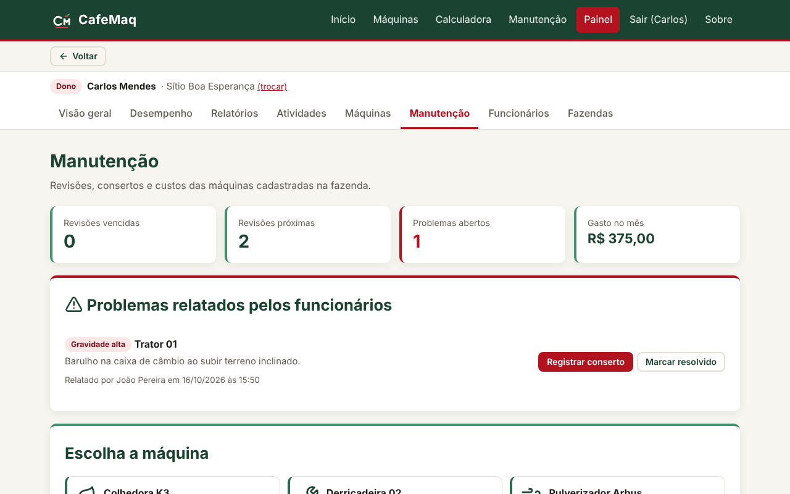
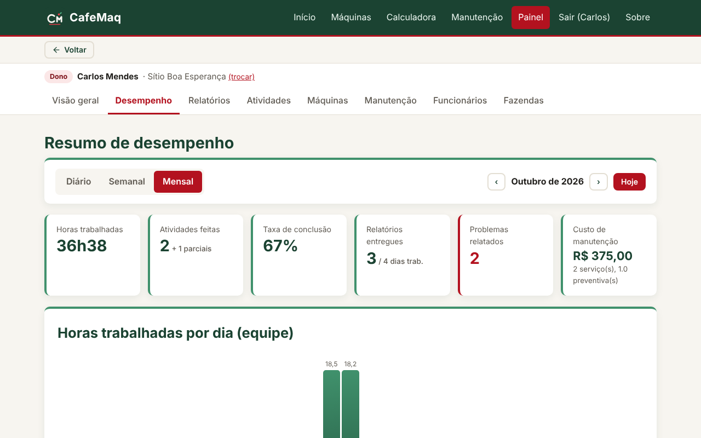

<div align="center">


# CafeMaq

**Gestão de máquinas, manutenção e equipe para fazendas de café**


Projeto Interdisciplinar · Curso Técnico em Informática · IFRO Campus Ariquemes · 2026

</div>

---

O CafeMaq ajuda o produtor de café a cuidar do maquinário e da equipe em um só lugar. O **dono** cadastra
fazendas, máquinas e funcionários, cria atividades e acompanha custos e revisões. O **funcionário** bate o
ponto pelo celular e, no fim do dia, envia o relatório do que fez — com horímetro e problemas nas máquinas,
que viram alertas de manutenção para o dono.

<p align="center">
  
  
</p>
<p align="center">
  
  
</p>

## Funcionalidades

- **Site institucional** com catálogo de máquinas cafeeiras, calculadora de custo de manutenção e dicas.
- **Painel do dono:** visão geral, desempenho por dia/semana/mês, relatórios da equipe, atividades,
  cadastro de máquinas (com catálogo de marcas e modelos), manutenção, funcionários e várias fazendas.
- **Manutenção preventiva pelo horímetro:** o sistema avisa quando a revisão está próxima ou vencida.
- **Painel do funcionário** (feito para celular): ponto de entrada/saída, relatório do dia e histórico.
- **Problemas relatados** viram alertas; ao registrar o conserto, o problema é resolvido automaticamente.
- **Login com e-mail e senha ou com o Google.**

## Tecnologias

| Camada | Tecnologia |
|---|---|
| Back-end | Python 3 + Flask (blueprints), API REST em JSON |
| Banco de dados | MySQL 8 (usuários, funções, procedimentos e triggers) · SQLite para teste rápido |
| Front-end | HTML5 + Jinja2, CSS responsivo, JavaScript puro (`fetch`) |
| Segurança | Hash scrypt, CSRF, sessões com expiração, limite de tentativas, logs e auditoria |

## Como rodar

Precisa do **Python 3.10+** e, para o banco oficial, do **MySQL 8** (ou MySQL Workbench / XAMPP).

```bash
git clone https://github.com/edvanviegas/cafe_maq.git
cd cafe_maq
pip install -r requirements.txt
cp .env.example .env          # no Windows: copy .env.example .env
```

**Com MySQL (oficial):**

```bash
python scripts/instalar_banco.py --exemplo    # cria base, usuários, rotinas e dados de exemplo
```

No `.env`, deixe `DB_TIPO=mysql`, coloque a senha do usuário `cafemaq_app` em `DB_SENHA` e gere uma
`SECRET_KEY` com `python -c "import secrets; print(secrets.token_hex(32))"`.

**Sem instalar nada (SQLite):** no `.env`, troque para `DB_TIPO=sqlite`. O banco é criado sozinho.

```bash
python app.py
```

Abra <http://localhost:5000>. Com os dados de exemplo, entre com `dono@cafemaq.com.br` ou
`joao@cafemaq.com.br` (senha `Cafe@2026`).

## Documentação

| Disciplina | O que tem | Onde |
|---|---|---|
| **Banco de Dados II** | Modelo lógico e físico, usuários (admin + aplicação + backup), 3 funções, 3 procedimentos, 9 triggers, dump | [`docs/banco-de-dados.md`](docs/banco-de-dados.md) · [`database/mysql`](database/mysql) |
| **Programação Web** | CRUD completo com `GET`, `POST`, `PUT`, `PATCH` e `DELETE`, estrutura do Flask | [`docs/api.md`](docs/api.md) |
| **Segurança da Informação** | 7 mecanismos (CID): acesso, logs/auditoria, força bruta, sessão, políticas, backup, proteções web | [`docs/seguranca.md`](docs/seguranca.md) |
| **Projeto e Desenvolvimento de Sistemas** | Kanban no GitHub Projects, publicação | [Issues](https://github.com/edvanviegas/cafe_maq/issues) · [`docs/deploy.md`](docs/deploy.md) |

## Estrutura

```
cafe_maq/
├── app.py                  # cria o app Flask (é o arquivo que se executa)
├── config.py               # configurações lidas do .env
├── banco.py                # conexão MySQL/SQLite e consultas parametrizadas
├── utils.py                # datas, formatação e segurança (CSRF, sessão, logs, senhas)
├── catalogo.py             # catálogo de tipos, marcas e modelos de máquinas
├── rotas/                  # publico, auth, dono, funcionario e api (REST)
├── templates/              # páginas HTML (Jinja2)
├── static/                 # CSS, JavaScript e imagens
├── database/
│   ├── mysql/              # 01_estrutura, 02_usuarios, 03_rotinas, 04_dados_exemplo, dump
│   └── sqlite/schema.sql   # versão de teste
├── scripts/                # instalar_banco.py e backup.py
└── docs/                   # documentação, modelo lógico e telas
```

## Como funciona

1. O **dono** cria a conta, cadastra a fazenda, as máquinas e os funcionários (pelo e-mail).
2. O **funcionário** cria a conta (ou entra com Google) com o mesmo e-mail e é vinculado automaticamente.
3. O dono cria **atividades** (únicas ou diárias), com responsável e máquina.
4. O funcionário **bate o ponto** e, no fim do dia, envia o **relatório**: o que fez, horas, horímetro e
   problemas nas máquinas.
5. Problemas viram **alertas** na aba **Manutenção**, onde o dono vê a situação da revisão, marca o checklist
   preventivo, registra serviço e custo e agenda manutenções.
6. A aba **Desempenho** resume horas, atividades, relatórios, problemas e custos por máquina.

## Equipe

| | Integrante | Responsabilidades |
|---|---|---|
|  | **Hiago Amaral** · [@HIAGO-AMARAL](https://github.com/HIAGO-AMARAL) | Líder · back-end, banco de dados e HTML |
|  | **Edvan Henrique** · [@edvanviegas](https://github.com/edvanviegas) | Front-end |

<sub>Projeto acadêmico desenvolvido para o Projeto Interdisciplinar do 4º bimestre do IFRO — Campus Ariquemes.</sub>
