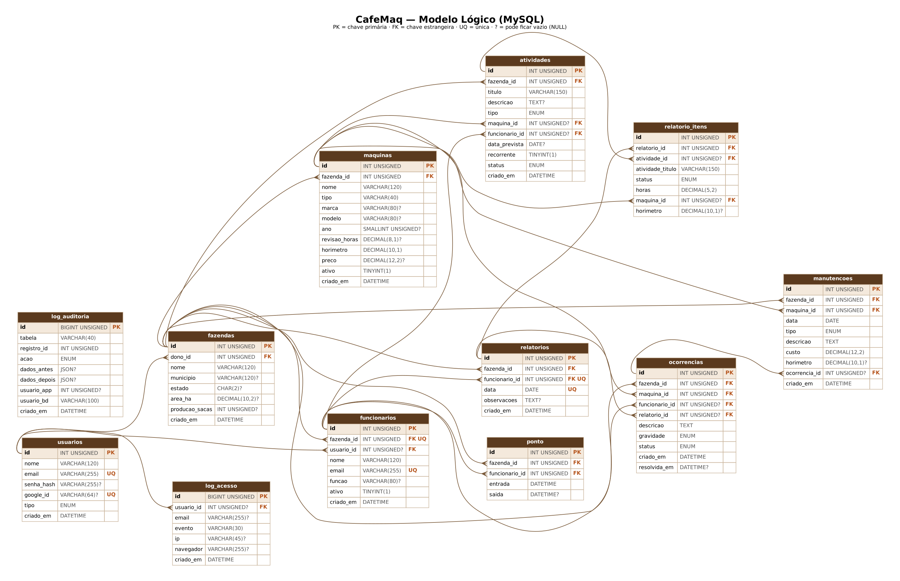
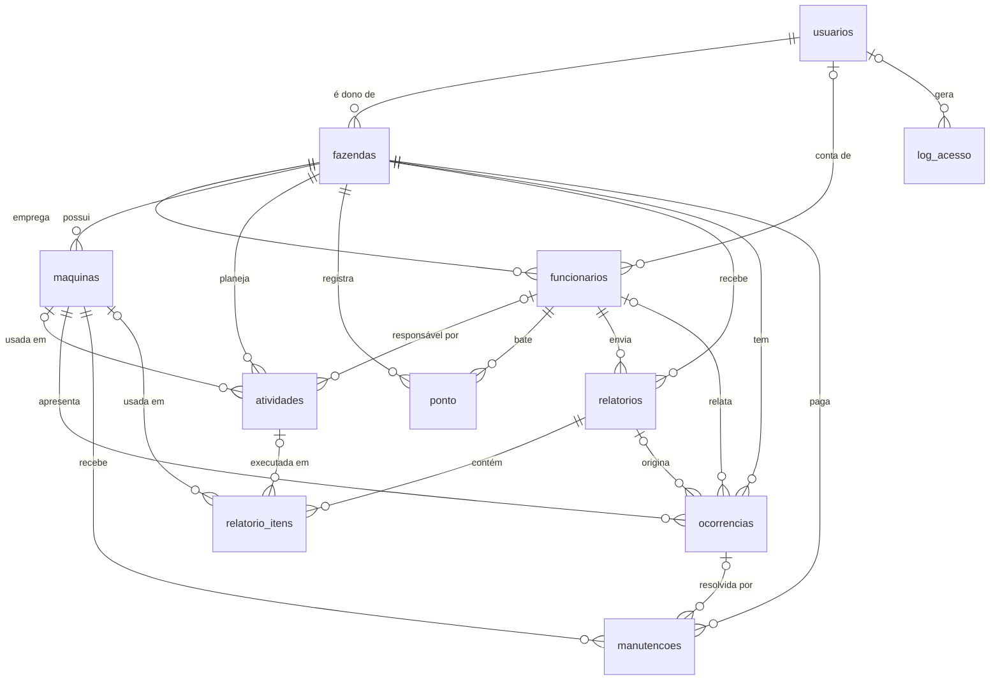

# Banco de Dados — CafeMaq

Documentação da disciplina **Banco de Dados II**. O banco oficial do projeto é o **MySQL 8**
(base `cafemaq`). Todos os scripts estão em [`database/mysql`](../database/mysql) e são comentados linha a linha.

| Entregável | Arquivo |
|---|---|
| Modelo lógico (diagrama) | [`docs/modelo-logico.png`](modelo-logico.png) · [`.svg`](modelo-logico.svg) |
| Modelo físico (DDL) | [`database/mysql/01_estrutura.sql`](../database/mysql/01_estrutura.sql) |
| Usuários e permissões | [`database/mysql/02_usuarios.sql`](../database/mysql/02_usuarios.sql) |
| Funções, procedimentos e gatilhos | [`database/mysql/03_rotinas.sql`](../database/mysql/03_rotinas.sql) |
| Dados de demonstração | [`database/mysql/04_dados_exemplo.sql`](../database/mysql/04_dados_exemplo.sql) |
| Cópia de segurança (dump) | [`database/mysql/cafemaq_dump.sql`](../database/mysql/cafemaq_dump.sql) |

## Instalação

```bash
# Opção 1: tudo de uma vez (pede a senha do root)
python scripts/instalar_banco.py --exemplo

# Opção 2: script por script (terminal ou MySQL Workbench > File > Run SQL Script)
mysql -u root -p < database/mysql/01_estrutura.sql
mysql -u root -p < database/mysql/02_usuarios.sql
mysql -u root -p < database/mysql/03_rotinas.sql
mysql -u root -p < database/mysql/04_dados_exemplo.sql   # opcional

# Opção 3: restaurar o dump pronto (estrutura + dados + rotinas) e depois criar os usuários
mysql -u root -p < database/mysql/cafemaq_dump.sql
mysql -u root -p < database/mysql/02_usuarios.sql
```

> **Diagrama no MySQL Workbench:** depois de instalar, use *Database → Reverse Engineer* na base `cafemaq`
> para gerar o EER Diagram (`.mwb`) a partir do banco real.

## Modelo lógico



O mesmo modelo em Mermaid (o GitHub desenha sozinho):



### Tabelas

| Tabela | Para que serve |
|---|---|
| `usuarios` | Contas de acesso (dono ou funcionário). Senha só como hash. |
| `fazendas` | Propriedades de café de cada dono. |
| `funcionarios` | Vínculo pessoa ↔ fazenda (o dono cadastra pelo e-mail). |
| `maquinas` | Maquinário com horímetro, intervalo de revisão e valor. |
| `atividades` | Tarefas do dia a dia e manutenções agendadas. |
| `ponto` | Entrada e saída dos funcionários. |
| `relatorios` / `relatorio_itens` | Relatório diário e o que foi feito em cada atividade. |
| `ocorrencias` | Problemas relatados nas máquinas (alertas para o dono). |
| `manutencoes` | Serviços preventivos/corretivos com custo. |
| `log_acesso` | Log de autenticação gravado pela aplicação. |
| `log_auditoria` | Trilha de auditoria gravada pelos gatilhos. |

**Integridade:** chaves estrangeiras com `ON DELETE CASCADE` (dados que só existem dentro da fazenda) ou
`SET NULL` (histórico que deve continuar existindo), `UNIQUE` (e-mail, um relatório por dia), `ENUM`
nos campos de valores fixos e `CHECK` (horímetro e custo não negativos, saída depois da entrada,
horas entre 0 e 24).

## Usuários do banco (mínimo de 2 — temos 3)

| Usuário | Papel | Permissões |
|---|---|---|
| `cafemaq_admin` | **Administrador** da base | `ALL PRIVILEGES` **só** em `cafemaq.*`, com `GRANT OPTION` |
| `cafemaq_app` | **Aplicação** Flask (usado no `.env`) | `SELECT/INSERT/UPDATE/DELETE` tabela por tabela, `EXECUTE` nas rotinas, e nos logs **só** `SELECT/INSERT` |
| `cafemaq_backup` | Rotina de backup | Somente leitura (`SELECT, SHOW VIEW, TRIGGER, LOCK TABLES, EVENT`) |

O usuário da aplicação **não consegue**: criar/apagar tabelas, apagar ou alterar logs, nem ler outras
bases do servidor. Para demonstrar:

```sql
SHOW GRANTS FOR 'cafemaq_app'@'localhost';
-- logado como cafemaq_app:
DELETE FROM log_auditoria;      -- ERRO 1142: command denied
DROP TABLE maquinas;            -- ERRO 1142: command denied
SELECT * FROM mysql.user;       -- ERRO 1044: access denied
```

## Funções

| Função | Retorna | Exemplo |
|---|---|---|
| `fn_custo_maquina(maquina, inicio, fim)` | Custo de manutenção no período | `SELECT fn_custo_maquina(1, '2026-01-01', '2026-12-31');` |
| `fn_horas_desde_preventiva(maquina)` | Horas rodadas desde a última revisão (NULL se nunca teve) | `SELECT nome, fn_horas_desde_preventiva(id) FROM maquinas;` |
| `fn_horas_trabalhadas(funcionario, inicio, fim)` | Horas de ponto no período | `SELECT nome, fn_horas_trabalhadas(id, '2026-10-01', '2026-10-31') FROM funcionarios;` |

## Procedimentos

| Procedimento | O que faz | Exemplo |
|---|---|---|
| `sp_resumo_custos(fazenda, inicio, fim)` | Ranking de custo por máquina (usa as duas primeiras funções). **Usado pelo site** na página Desempenho e em `GET /api/fazenda/custos`. | `CALL sp_resumo_custos(1, '2026-01-01', '2026-12-31');` |
| `sp_registrar_manutencao(...)` | Registra um serviço dentro de uma **transação**, valida a máquina e o tipo, e faz `ROLLBACK` em caso de erro. | `CALL sp_registrar_manutencao(1, 2, CURDATE(), 'preventiva', 'Troca de óleo', 850, 1500, NULL, @id); SELECT @id;` |
| `sp_fechar_pontos_esquecidos(fazenda, horas)` | Fecha pontos abertos há mais de N horas. | `CALL sp_fechar_pontos_esquecidos(1, 12);` |

## Gatilhos (triggers)

| Gatilho | Quando | O que faz |
|---|---|---|
| `trg_manutencoes_antes_inserir` | BEFORE INSERT em `manutencoes` | Bloqueia custo/horímetro negativo com `SIGNAL` |
| `trg_manutencoes_depois_inserir` | AFTER INSERT em `manutencoes` | Atualiza o horímetro da máquina, resolve o problema ligado e audita |
| `trg_ocorrencias_antes_atualizar` | BEFORE UPDATE em `ocorrencias` | Preenche/limpa `resolvida_em` sozinho |
| `trg_maquinas_depois_atualizar` / `_excluir` | AFTER UPDATE/DELETE em `maquinas` | Auditoria com o antes e o depois em JSON |
| `trg_funcionarios_depois_atualizar` / `_excluir` | AFTER UPDATE/DELETE em `funcionarios` | Auditoria |
| `trg_fazendas_depois_excluir` | AFTER DELETE em `fazendas` | Auditoria |
| `trg_usuarios_depois_atualizar` | AFTER UPDATE em `usuarios` | Auditoria **sem** copiar o hash da senha |

Os gatilhos de auditoria registram **quem** fez a mudança: o usuário do MySQL (`CURRENT_USER()`) e a
pessoa logada no site — o Flask envia `SET @app_usuario_id = <id>` a cada requisição (`banco.py`).

Roteiro para demonstrar na apresentação:

```sql
-- 1) o gatilho barra dado inválido
INSERT INTO manutencoes (fazenda_id, maquina_id, data, tipo, descricao, custo)
VALUES (1, 1, CURDATE(), 'corretiva', 'teste', -10);       -- ERRO: custo não pode ser negativo

-- 2) o gatilho atualiza o horímetro e resolve o problema
SELECT horimetro FROM maquinas WHERE id = 1;                 -- 4994.0
CALL sp_registrar_manutencao(1, 1, CURDATE(), 'corretiva', 'Conserto do câmbio', 2300, 5000, 1, @id);
SELECT horimetro FROM maquinas WHERE id = 1;                 -- 5000.0
SELECT status, resolvida_em FROM ocorrencias WHERE id = 1;   -- resolvida, data de agora

-- 3) a auditoria registrou tudo
SELECT tabela, acao, usuario_bd, dados_antes, dados_depois FROM log_auditoria ORDER BY id DESC LIMIT 5;

-- 4) funções e procedimento de relatório
CALL sp_resumo_custos(1, '2026-01-01', '2026-12-31');
```

## Backup (dump)

- Dump pronto: [`database/mysql/cafemaq_dump.sql`](../database/mysql/cafemaq_dump.sql).
- Dump novo do seu banco: `python scripts/backup.py` (usa o `mysqldump` com o usuário `cafemaq_backup`)
  ou, no Workbench, *Server → Data Export* marcando *Dump Stored Procedures and Functions* e *Dump Triggers*.
- Detalhes da rotina de backup e recuperação em [`seguranca.md`](seguranca.md#6-backup-e-recuperação).
